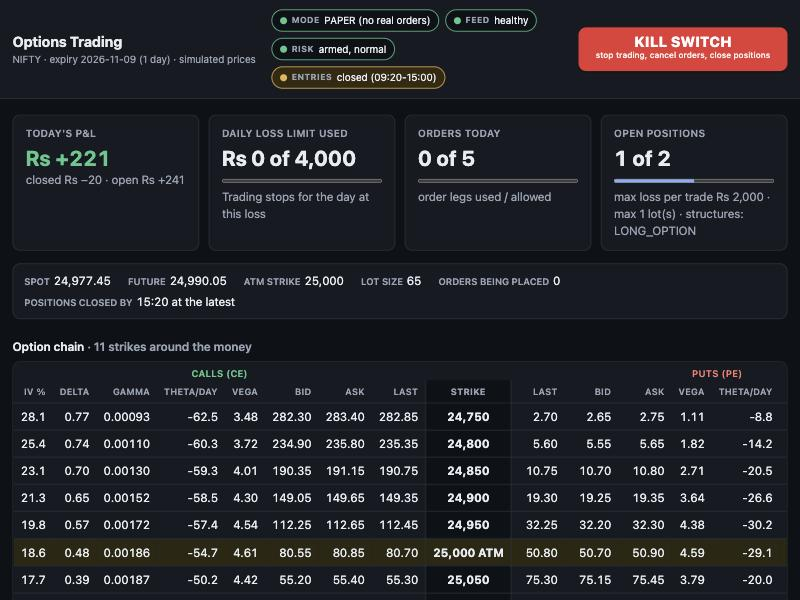
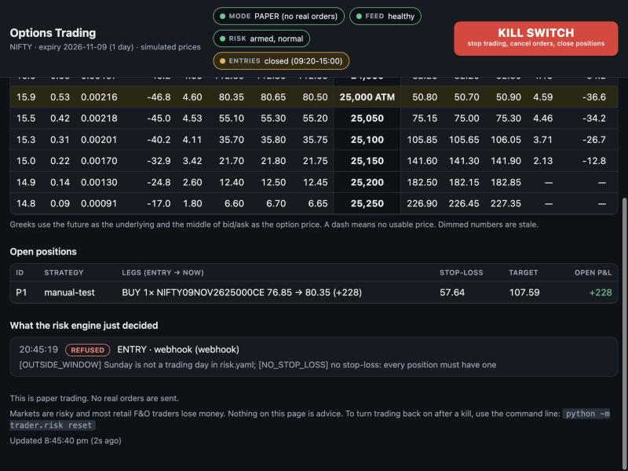
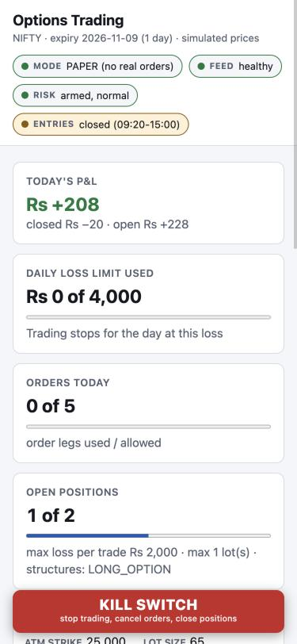
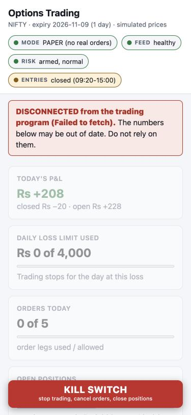

# Beginner's Guide: from download to your first paper trade

**NIFTY Options Trading Assistant** - an open-source, paper-first toolkit for learning options trading with Angel One's SmartAPI.

This guide is for complete beginners. You do not need to know programming. It takes you step by step from downloading the project
from GitHub, to creating your Angel One API key, to putting it in the right place, to using the application every day.

> **Read this first.** Markets are risky. **Most retail F&O traders lose money.** This software is for learning and practice. It is
> not investment advice, it does not promise profit, and the included example strategy is "example only, not tested for profit".
> It starts in **paper mode**: no real orders, no real money. Never trade money you cannot afford to lose completely.

---

## 0. Before you start

### What you need

- **A computer** (Mac, Windows or Linux) that you can leave on and connected to the internet during market hours (Monday to Friday, about 09:15 to 15:30 India time).
- **About 1 to 2 hours** the first time.
- **An Angel One trading and demat account** - only needed for *real* market prices. You can try everything first on practice prices without one.
- **A free Telegram account** - optional, but strongly recommended, for alerts on your phone and an emergency stop button.
- **No money is needed to start.** Paper trading uses pretend money.

### How the guide is organised

1. Install two free programs (Git and Docker Desktop).
2. Download the project from GitHub.
3. Run it once on practice prices (safe, no accounts).
4. Create your Angel One API key and TOTP secret.
5. Put your details in the settings file and check the login.
6. Set up phone alerts.
7. Use it every day.
8. Troubleshooting, glossary, and a cheat sheet.

### Three golden rules

1. **Your settings file (`.env`) holds passwords. Never share it, post it, screenshot it, or upload it.**
2. **Leave `LIVE_TRADING=false`.** That keeps everything on paper. Going live is a separate, serious step (Part 9).
3. **If in doubt, press the KILL SWITCH.** It is always safe to stop.

---

## 1. Install the tools

You need two free programs: **Git** (downloads the project) and **Docker Desktop** (runs the project in a safe, self-contained box so you do not have to install anything else).

### On a Mac

1. Install **Docker Desktop for Mac** from the Docker website (docker.com, "Docker Desktop"). Open it and wait until it says it is running (a whale icon in the top bar).
2. Install **Git**. Open the **Terminal** app (press Cmd+Space, type "Terminal", press Enter) and type `git --version`. If Git is missing, your Mac offers to install it: say yes.

### On Windows

1. Install **Git for Windows** from git-scm.com. During setup, accept the defaults. It includes **Git Bash**, which you will use for commands.
2. Install **Docker Desktop for Windows** from docker.com. Its installer may ask to turn on "WSL 2" and restart the computer. Say yes. Open Docker Desktop afterwards and wait until it says it is running.
3. From now on, open **Git Bash** (Start menu, type "Git Bash") whenever this guide says "Terminal".

### Check that it worked

In the Terminal, type each line below and press Enter. Each should print a version number:

```
git --version
docker --version
docker compose version
```

> If `docker` says it cannot connect, Docker Desktop is not running yet. Open it and wait a minute.

---

## 2. Download the project from GitHub

In the Terminal, go to a folder where you keep things (for example your home folder) and download ("clone") the project:

```
git clone https://github.com/<your-account>/<repo-name>.git
cd <repo-name>
```

Now you are inside the project folder. Type `ls` to list what is there. The parts you will use:

| Name | What it is |
|---|---|
| `README.md` | The overview and the full daily runbook |
| `.env.example` | A template for your settings file |
| `scripts/` | Simple start, stop and kill commands |
| `config/` | The rules and safety limits (plain text files) |
| `docs/` | More guides (this guide, Telegram, TradingView, backtesting) |
| `data/` | Appears after the first run: your trade journal and records |

> **No Git?** On the GitHub page you can press the green **Code** button, then **Download ZIP**, and unzip it. That works for a first try, but you will not be able to download updates easily.

---

## 3. First run on practice prices (safe, no accounts)

This proves everything works before you touch any password. Prices are made up. Orders are paper orders.

### Step 3.1: create your settings file

The settings file is called `.env` (note the dot at the start). Create it by copying the template:

```
cp .env.example .env
```

(On Windows PowerShell use `Copy-Item .env.example .env`. In Git Bash, `cp` works.)

### Step 3.2: make a secret password for the webhook

The program needs one long random password even for practice. The easiest way that works on every computer is to ask Docker to make one:

```
docker run --rm python:3.13-slim-bookworm python -c "import secrets; print(secrets.token_urlsafe(32))"
```

It prints something like `k3J...` (about 43 characters). Copy it. This is the first time it downloads a small file, so it can take a minute.

### Step 3.3: edit the settings file

Open `.env` in a plain text editor. The file starts with a dot, so it may be hidden:

- **Mac:** in Terminal type `open -e .env` (opens TextEdit).
- **Windows:** in Git Bash type `notepad .env`.

Find these lines and fill them in. Leave everything else blank for now:

```
TRADER_FEED=simulated
WEBHOOK_SECRET=paste-the-long-password-here
LIVE_TRADING=false
```

Save the file and close the editor.

### Step 3.4: start it

```
scripts/start.sh
```

(On Windows without Git Bash, run `docker compose up -d --build` instead.) The first time it builds the program, which takes a few minutes. When it finishes it says **Started**.

### Step 3.5: open the dashboard

Open your web browser and go to **http://127.0.0.1:8000/**. You should see the dashboard:



What you are looking at:

- **PAPER** at the top: no real orders. Always check this.
- **FEED healthy**: prices are fresh. If it says UNHEALTHY, new trades are blocked automatically.
- **Today's P&L** and the **limit bars**: how much of your safety limits are used.
- **Option chain**: option prices with their "Greeks" (explained in the glossary). The highlighted row is "at the money".
- **KILL SWITCH**: stops everything. Always visible.

Scroll down for your positions and the risk engine's decisions:



> **Do not worry if no trades happen.** Entries are only allowed Monday to Friday between 09:20 and 15:00. Outside that, the program correctly refuses trades with the reason `OUTSIDE_WINDOW`. Refusals are normal and are shown on the dashboard. That is the safety system doing its job.

### Step 3.6: stop it

```
scripts/stop.sh
```

You have now run the whole system. Next you will connect real prices.

---

## 4. Create your Angel One API key and TOTP secret

To use **real market prices** you need to give the program permission to log in to your Angel One account through their API ("SmartAPI"). You need four things:

| Setting in `.env` | What it is | Where it comes from |
|---|---|---|
| `ANGEL_CLIENT_ID` | Your Angel One client code, like `A123456` | Your Angel One account |
| `ANGEL_PIN` | Your 4 digit Angel One login PIN (MPIN) | Your Angel One account |
| `ANGEL_API_KEY` | A key that identifies your "app" | Created in the SmartAPI portal (Step 4.2) |
| `ANGEL_TOTP_SECRET` | The secret behind your one-time login codes | Created on the SmartAPI TOTP page (Step 4.3) |

> **Important:** Angel One changes its website from time to time. The steps below follow the process as it was described in Angel One's own guides and community posts when this guide was written. **Button names and web addresses may differ slightly.** If something looks different, use Angel One's official guide as the reference:
> [How to generate a SmartAPI key](https://www.angelone.in/knowledge-center/smartapi/how-to-generate-smartapi-key-and-install-python-on-your-machine)

### Step 4.1: make sure you have an Angel One account

You need an active Angel One trading and demat account (KYC done) with options trading enabled. Have your **client code**, your **PIN**, and your **registered mobile phone and email** at hand, because Angel One sends you one-time codes.

### Step 4.2: create your API key

1. Go to the Angel One **SmartAPI** website (smartapi.angelone.in; older guides use smartapi.angelbroking.com) and **sign up or sign in** with your client code, PIN and the one-time code (OTP) Angel One sends you.
2. Open **My Apps** (or "My Profile"), then press **Create App**.
3. Fill in the form:
   - **App name:** anything, for example `my-paper-trading`.
   - **Type of API:** choose the option that includes **Trading APIs** and market data. (You need market data now. Order placement is only used if you ever go live.)
   - **Redirect URL:** these guides use a harmless placeholder such as `https://www.google.com`. This project does not use it.
   - **Your client code:** enter it if asked.
4. Create the app. You are shown an **API Key** and a **Secret Key**.

**Copy the API Key.** That is your `ANGEL_API_KEY`. You will also see a **Secret Key**: this project does **not** use it, so do not paste it anywhere.

### Step 4.3: turn on TOTP and copy the secret

TOTP is the 6 digit code that changes every 30 seconds (like in Google Authenticator). The program makes those codes itself, so it needs the secret behind them.

1. On the SmartAPI site, open the **Enable TOTP** page (look for "Enable TOTP" or open smartapi.angelone.in/enable-totp).
2. Enter your **client code** and **PIN**, then the **OTP** sent to your phone or email.
3. The page shows a **QR code** and, underneath, a **text key** (a string of capital letters and numbers).
4. **Copy that text key.** That is your `ANGEL_TOTP_SECRET`. It is usually shown only once, so store it safely right away. It is as sensitive as a password.
5. Optional: also scan the QR code with an authenticator app so you have normal codes on your phone too.

> **Check your computer's clock.** TOTP codes depend on the exact time. Make sure your computer's date and time are set to **automatic**. A clock that is even a minute wrong makes the login fail with "Invalid TOTP".

### Step 4.4: a note about a "static IP"

For *placing real orders* through the API, Angel One's rules (as of this writing) require you to register a fixed internet address ("static IP"). You do **not** need that for paper trading with real prices. It matters only if you ever go live. See the go-live checklist in Part 9.

### Step 4.5: keep your credentials safe

- Never share them, post them, or put them in a screenshot.
- Anyone with all four values can access your account. Treat them like your bank password.
- If you think they have leaked: change your PIN with Angel One, and regenerate the API key and TOTP in the SmartAPI portal.

---

## 5. Put your details in `.env` and test the login

### Step 5.1: edit `.env`

Open it again (`open -e .env` on Mac, `notepad .env` on Windows) and fill in the four values. No spaces and no quotes around them:

```
TRADER_FEED=live
ANGEL_CLIENT_ID=A123456
ANGEL_PIN=1234
ANGEL_API_KEY=your-api-key-here
ANGEL_TOTP_SECRET=YOURLONGSECRETKEYHERE
WEBHOOK_SECRET=the-long-password-from-step-3
LIVE_TRADING=false
```

(The values above are examples, not real.) Keep **`LIVE_TRADING=false`**. With `TRADER_FEED=live` you get **real prices** but your orders are still **paper orders**.

### Step 5.2: test the login (places no orders)

```
docker compose run --rm trader python -m trader.auth
```

You should see: **`Login OK for client A123456. Your Angel One settings work. (No orders were placed.)`**

If you see **`Login FAILED`**, read the message. Common causes:

| Message mentions | Likely fix |
|---|---|
| Invalid TOTP | Your computer's clock is off (set it to automatic), or `ANGEL_TOTP_SECRET` was copied wrongly (no spaces, all letters and numbers). |
| Invalid credentials / PIN | Check `ANGEL_CLIENT_ID` and `ANGEL_PIN` (the 4 digit PIN, not your old long password). |
| Invalid API key | Re-copy `ANGEL_API_KEY` from the SmartAPI portal (the API Key, not the Secret Key). |
| Could not reach Angel One | Check your internet connection and try again. |
| Account locked | Too many wrong attempts. Wait, then fix the values before retrying. |

### Step 5.3: start it with real prices

```
scripts/start.sh
```

Open **http://127.0.0.1:8000/**. During market hours the **FEED** badge should turn **healthy** and the option chain should show real prices. (Outside market hours there are no prices to show, so the feed looks quiet. That is normal.)

---

## 6. Set up phone alerts (recommended)

Telegram can message you about every signal, order, fill, refusal and problem, and give you an emergency `/kill` button on your phone.

1. In Telegram, search for **@BotFather** (the one with the blue tick), send `/newbot`, and follow the prompts. BotFather gives you a **token** (a long string with a colon). Treat it like a password.
2. In `.env`, set `TELEGRAM_BOT_TOKEN=` to that token.
3. Open your new bot in Telegram and press **Start** (a bot cannot message you first).
4. Find your personal chat number:
   ```
   docker compose run --rm trader python -m trader.alerts whoami
   ```
   Put the number in `.env` as `TELEGRAM_CHAT_ID=`.
5. Test it:
   ```
   docker compose run --rm trader python -m trader.alerts test
   ```
   A test message should arrive on your phone.
6. Restart so it takes effect: `docker compose restart`.

Only **your** chat can give commands. Anyone else who finds the bot is ignored. Full details are in `docs/telegram.md`.

### Optional but valuable: a "dead man's switch"

A crashed program cannot tell you it crashed. A free service such as healthchecks.io fixes that: create a check that expects a ping every minute or two, copy its ping URL into `HEARTBEAT_URL=` in `.env`, and restart. If the pings stop, *they* message you.

---

## 7. Using it every day

### The idea in one picture

A trade idea (from the built-in rules or from a TradingView alert) goes through the **risk engine**. The risk engine checks your limits and either **approves** or **refuses** it, and says why. Approved ideas become **paper orders**. Everything is written to your **journal**, and your phone is told.

### Every morning (before 09:15)

- Open the dashboard. It should say **PAPER** and the **RISK** badge should say "armed, normal".
- Send `/status` to your Telegram bot: you should get a reply.
- Make sure the computer is awake, plugged in, and online, and Docker Desktop is running.
- There should be no leftover positions from yesterday.

The system restarts itself at 08:30 every day to pick up the new day's contracts.

### During the day

You do not need to watch it. Alerts come to your phone through Telegram. The dashboard shows the live picture, but **it can only be opened on the computer that runs the program** (that is deliberate, for safety). Your phone is for Telegram. The page also fits narrow windows, where the kill switch stays pinned to the bottom:



Entries are allowed between 09:20 and 15:00. Everything is closed by 15:15, and the system forces it by 15:20.

### Every evening: the review (10 minutes)

At 15:45 a **daily summary** arrives. Then do the **evening review**, the most useful habit in the whole system:

```
scripts/review.sh "Your Name"
```

For each trade it shows why it was taken and why it ended, and asks: **did this trade follow the rules? (y/n)**. Add a note if something is worth remembering. This is how you learn to tell a good rule from luck.

### Every Friday: the weekly summary

```
scripts/summary.sh
```

It shows the win rate, average win and loss, biggest drawdown, results by type of trade, and how many trades followed the rules. Be honest about small samples: **under about 30 trades, the numbers are mostly luck.** Write what you learned in `config/EXPERIMENTS.md`.

### The kill switch: three ways

It blocks all new orders, cancels pending orders and closes every position, and it **stays on until a person resets it**, even after a restart.

1. **Dashboard:** press the big red **KILL SWITCH** button and confirm.
2. **Telegram:** send `/kill`.
3. **Terminal:** `scripts/kill.sh`.

To turn trading back on, send `/reset` in Telegram (it gives you a one-time code to send back with a reason), or run `scripts/reset.sh "Your Name" "why it is safe"`.

### If the data feed stops

If you see a "market data down" alert, or the page shows a red **DISCONNECTED** or **DATA IS STALE** banner, do not trust the numbers:



If you have an open position, close it (kill switch, and check the Angel One app). Then check your internet and the log (`scripts/logs.sh`), and if needed restart with `scripts/stop.sh` and `scripts/start.sh`.

### Changing the rules

The rules and limits are plain text files in `config/`. Changing them is a deliberate act: decide what you expect first, change one thing at a time, raise the `version:` number, write it in `config/CHANGELOG.md`, save it in git (`git add config`, then `git commit -m "what and why"`), then run `docker compose restart`. The README explains this in full. This habit keeps you from fooling yourself.

### Updating the software

When new versions are published: `git pull`, then `scripts/start.sh` to rebuild and restart. Your `.env`, your journal and your rule files are kept.

---

## 8. Troubleshooting

| Problem | What to do |
|---|---|
| `docker: command not found` or cannot connect | Install Docker Desktop and open it. Wait until it says it is running. |
| `scripts/start.sh` says "No .env file" | Do Step 3.1. The file must be named exactly `.env`. |
| Program stops straight away | Run `scripts/logs.sh`. A missing or weak `WEBHOOK_SECRET` (needs 16 or more characters) is the most common cause. |
| "Missing Angel One settings" | You set `TRADER_FEED=live` but left the Angel One lines blank. Fill them in, or set `TRADER_FEED=simulated`. |
| "Login FAILED" | See the table in Step 5.2. Usually the computer's clock, the PIN, or a mistyped key. |
| Dashboard will not open | Check the program is running (`scripts/status.sh`) and use exactly `http://127.0.0.1:8000/`. |
| Feed UNHEALTHY | Normal outside market hours and on exchange holidays. During market hours check your internet and the log. |
| Lots of refused signals | Read the reason on the dashboard. A common one: with NIFTY's lot size of 65, a 25% stop on a Rs 100 option already risks about Rs 1,600 per lot, so a Rs 2,000 per-trade limit refuses costly options. That is the limit working. |
| No Telegram messages | Run the Telegram test (Part 6). Check you pressed Start on your bot and that the chat number is right. |
| Port already in use | Another program is using port 8000. Stop it, or stop the old copy with `scripts/stop.sh`. |
| I want to start fresh | `scripts/stop.sh`, then rename the `data` folder (never delete it if you want to keep your journal). |

Still stuck? Open an issue on the GitHub page. **Never paste your `.env` or any key, token or PIN.**

---

## 9. Before you ever use real money

This project **starts and stays on paper**. Going live is a separate, serious decision. Real orders need **two keys**: `LIVE_TRADING=true` in `.env`, **and** you typing a confirmation phrase at the keyboard when you start. It can never start live mode unattended.

Do not consider it until you have worked through `docs/go-live-checklist.md`. The short version:

- At least **4 weeks** of paper trading with real prices, with your weekly and evening reviews done.
- Risk limits set to amounts you can afford to lose entirely.
- A **static IP** registered with Angel One for orders.
- **One lot only** at first.
- The **kill switch tested** all three ways, and Telegram plus the dead man's switch working.
- A first live order done as a deliberate, supervised 1 lot test, comparing the Angel One app with the dashboard.

**Be honest about what is and is not verified.** The automated tests are extensive, but the live Angel One connection and real order placement have never been run against Angel One's servers. That is exactly what the supervised first test is for. And paper results are optimistic: real fills are worse.

---

## Glossary

| Word | Meaning |
|---|---|
| **NIFTY** | India's NSE 50 stock index. The options in this project are on this index. |
| **Option (CE / PE)** | A contract. **CE** (call) gains if the index rises; **PE** (put) gains if it falls. If you only buy options, the most you can lose is what you paid. |
| **Strike** | The price level an option is tied to, such as 25000. |
| **Expiry** | The date an option ends. Weekly options expire on a set day each week. |
| **Lot size** | Options trade in fixed bundles. NIFTY's is currently 65. One lot = 65 units. |
| **ATM** | "At the money": the strike nearest to the current index price. |
| **Premium** | The price you pay for an option. |
| **Stop-loss** | A price at which you give up and exit a losing trade, to limit the loss. Every trade here must have one. |
| **Target** | A price at which you take profit. |
| **Paper trading** | Pretend trading with real prices but no real money. |
| **API key** | A code that identifies your "app" to Angel One. |
| **TOTP** | A 6 digit one-time code that changes every 30 seconds, used for secure login. |
| **MPIN / PIN** | Your 4 digit Angel One login PIN. |
| **Kill switch** | The emergency stop: blocks orders and closes positions. |
| **Greeks (delta, gamma, theta, vega)** | Numbers showing how an option's price reacts to the index moving (delta, gamma), to time passing (theta) and to changing volatility (vega). |
| **IV (implied volatility)** | How much movement the market is pricing in. |
| **Drawdown** | A fall from a previous high in your results. |
| **Journal** | The permanent record of every signal, decision, fill and trade. |
| **Backtest** | Replaying recorded past prices through the rules. Useful, but easy to fool yourself with. |

---

## Command cheat sheet

Run these in the Terminal, inside the project folder.

| I want to... | Command |
|---|---|
| Start (or rebuild and start) | `scripts/start.sh` |
| Stop (close positions first) | `scripts/stop.sh` |
| See if it is running | `scripts/status.sh` |
| Watch the log | `scripts/logs.sh` |
| **Emergency stop** | `scripts/kill.sh` |
| Re-enable after a kill | `scripts/reset.sh "Your Name" "why it is safe"` |
| Evening review | `scripts/review.sh "Your Name"` |
| Weekly summary | `scripts/summary.sh` |
| Check my Angel One login | `docker compose run --rm trader python -m trader.auth` |
| Find my Telegram chat number | `docker compose run --rm trader python -m trader.alerts whoami` |
| Send a Telegram test | `docker compose run --rm trader python -m trader.alerts test` |
| Apply changed rules | `docker compose restart` |
| Open the dashboard | http://127.0.0.1:8000/ |

On Windows without Git Bash, use the `docker compose ...` command inside each script instead (for example `docker compose up -d --build` to start and `docker compose down` to stop).

---

*This is an independent, open-source educational project. It is not affiliated with or endorsed by Angel One, TradingView, Telegram or Cloudflare. It provides no investment advice and no guarantee of any result. Use at your own risk.*
